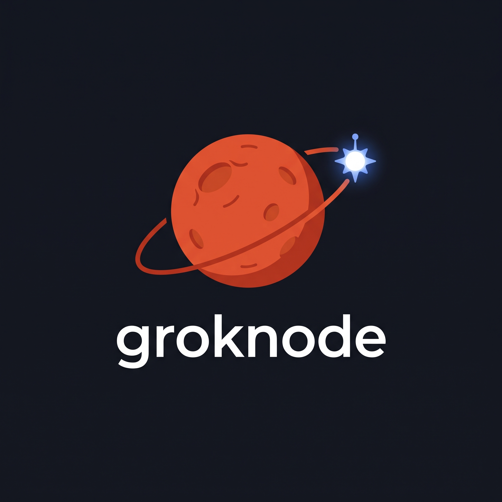

# groknode



[](https://github.com/TillmanBuildsTech/groknode/actions/workflows/github-code-scanning/codeql)
[](https://github.com/TillmanBuildsTech/groknode/releases/latest)

**Keep Grok's local-computer capability running 24/7 — without leaving your desktop on.**

groknode is a single, self-contained Go binary that runs Grok Bot's official
local-computer daemon headlessly on an always-on Linux box (a VM, an LXC, a
home server, a Raspberry Pi). Install it once, sign in, and Grok can keep
working on your machine whenever you need it — not just while your laptop is
awake with the app open.

It is an independent, unofficial management layer. It ships **no proprietary
code**, drives xAI's own daemon, and is MIT-licensed and fully open source.

📖 **User documentation:** https://tillmanbuildstech.github.io/groknode/

---

## Why you'd want this

Grok Bot's "local computer" feature lets Grok run commands and work with files
on a machine you control. Out of the box, that machine has to be *your
desktop*, with the Grok Bot app open and your screen on. Close the laptop and
the capability goes away.

groknode moves that capability onto a box that's always on:

- **Always available.** Grok's local-computer tasks keep working whether or not
  your desktop is awake. Run it on a cheap VM or an LXC and forget about it.
- **No desktop, no display server.** Runs completely headless — no X11, no
  Xvfb, no GUI. Just the binary and a systemd service.
- **One command to install.** The installer detects your distro and
  architecture, pulls the latest official Grok Bot release, installs every
  runtime library it needs, and wires up a hardened system service.
- **Set-and-forget supervision.** It signs in, mints and renews credentials
  automatically, launches the daemon, watches it, and restarts it with
  back-off if it ever crashes.
- **Runs locked down.** A dedicated, no-login service user; credentials stored
  at `0600`; a hardened systemd unit; outbound connections only — no inbound
  listener.

---

## Can you trust it?

That's the right question to ask of anything that can run commands on your
machine. Here's the honest answer:

- **It's fully open source (MIT).** Every line that runs as groknode is in this
  repository. Read it, audit it, build it yourself.
- **It redistributes no proprietary code.** The actual local-computer daemon is
  xAI's, and it comes only from the official Grok Bot package you install on
  your own box. groknode never bundles, ships, or modifies it — it only
  supervises it.
- **Your data goes exactly where it already did.** groknode talks to the same
  xAI/Cursor cloud endpoints the official app uses, with the same account. It
  adds no telemetry and no third parties. The data that flows to xAI is the
  same data that flows when you use the official app.
- **It's locked down by default.** The service runs as a dedicated `grokbot`
  user with no login shell, under a hardened systemd unit (`NoNewPrivileges`,
  `ProtectSystem=strict`, `ProtectHome`, a scoped `ReadWritePaths` sandbox, and
  an empty capability set). Grok's tasks can only touch directories you
  explicitly grant.
- **It warns you before it breaks.** This relies on an internal protocol that a
  vendor update could change. A nightly automated check downloads the current
  Grok Bot release and verifies everything groknode depends on — so breakage
  gets caught and tracked *before* it reaches you.

It is **unofficial** and **not endorsed by xAI or Cursor**. Because it rides an
undocumented internal protocol, a future Grok Bot update can break it until
groknode is updated to match. That's the one real caveat, and the nightly
watch exists specifically to manage it.

---

## Supported platforms

| Family | Architectures | Package |
|--------|---------------|---------|
| Debian / Ubuntu | x64, arm64 | `.deb` |
| Fedora / RHEL / CentOS | x64, arm64 | `.rpm` |
| Arch / CachyOS / Manjaro | x64, arm64 | AppImage |

No display server is required on any of them — only the shared libraries the
runtime links at load, which the installer handles for you.

---

## Install

You need a Linux box that stays on and an xAI account with Grok Bot access.
Prebuilt, static binaries are published for every release on the
[Releases page](https://github.com/TillmanBuildsTech/groknode/releases).

### One-line install (recommended)

Detects your architecture, downloads the matching release binary, verifies it
against the published checksums, and sets up the service. Add `--with-grokbot`
to also pull and install the official Grok Bot package plus its runtime
libraries:

```
curl -fsSL https://raw.githubusercontent.com/TillmanBuildsTech/groknode/main/scripts/get.sh | sudo bash -s -- --with-grokbot
```

Grok Bot already present? Drop the flag:

```
curl -fsSL https://raw.githubusercontent.com/TillmanBuildsTech/groknode/main/scripts/get.sh | sudo bash
```

Pin a specific version with `--version`:

```
curl -fsSL .../get.sh | sudo bash -s -- --version v0.1.0
```

### Manual download

Prefer to inspect what you run? Grab the archive for your platform, verify it,
and run the bundled installer:

| Platform | Architecture | Asset |
|----------|--------------|-------|
| Linux | x86_64 (Intel/AMD) | `groknode_<version>_linux_x64.tar.gz` |
| Linux | aarch64 (arm64) | `groknode_<version>_linux_arm64.tar.gz` |

```
# pick the matching asset + version from the Releases page
VER=0.1.0; ARCH=x64   # or ARCH=arm64
BASE=https://github.com/TillmanBuildsTech/groknode/releases/download/v$VER

curl -fsSLO $BASE/groknode_${VER}_linux_${ARCH}.tar.gz
curl -fsSLO $BASE/checksums.txt
sha256sum --ignore-missing -c checksums.txt     # verify integrity

tar xzf groknode_${VER}_linux_${ARCH}.tar.gz
sudo ./scripts/install.sh --with-grokbot ./groknode   # drop --with-grokbot if already installed
```

The standalone `groknode` binary inside the archive is fully self-contained —
you can also just drop it on your `PATH` and wire up the service yourself using
the bundled `packaging/systemd/groknode.service`.

### Build from source

With Go installed (see `go.mod` for the minimum version):

```
git clone https://github.com/TillmanBuildsTech/groknode
cd groknode
sudo ./scripts/install.sh --with-grokbot     # builds the binary, then installs
```

The installer creates the dedicated `grokbot` service user, lays down the
hardened systemd unit, and puts a single command on your `PATH`: **`groknode`**.
That's the only command you ever type.

### Finish setup

```
groknode fetch-runtime          # download the matching runtime
groknode check --local          # verify everything lines up
groknode login                  # sign in — prints a URL to open in your browser
groknode policy ask             # how Grok asks before acting: always | ask | never
sudo systemctl start groknode   # go live
```

`groknode login` prints a link; open it in any browser, approve, and you're
signed in. `groknode policy` controls whether local-computer actions require
your confirmation (`ask`), run freely (`always`), or are blocked (`never`).

---

## Everyday use

Everything is a subcommand of `groknode`:

| Command | What it does |
|---------|--------------|
| `groknode login` | Browser sign-in; stores your credentials |
| `groknode status` | Current node and daemon status (JSON) |
| `groknode check [--local]` | Verify compatibility (and sign-in) |
| `groknode policy <always\|ask\|never>` | Set how Grok is allowed to act locally |
| `groknode fetch-runtime` | Download/refresh the matching runtime |
| `groknode logout` | Remove credentials and local state |
| `groknode version` | Print version, commit, and build date |

Start, stop, and inspect the service with systemd as usual:

```
sudo systemctl status groknode
sudo systemctl stop groknode
journalctl -u groknode -f
```

## Keeping it current

After any Grok Bot update, refresh the runtime and restart:

```
groknode fetch-runtime && sudo systemctl restart groknode
```

## Granting access to your projects

By default Grok's tasks run sandboxed to groknode's own state directory. To let
Grok work in specific project folders, add those paths to `ReadWritePaths=` in
`/etc/systemd/system/groknode.service`, then
`sudo systemctl daemon-reload && sudo systemctl restart groknode`. Anything not
listed stays read-only or hidden.

---

## How it works (in brief)

groknode handles the sign-in, credential, and supervision work, and hands the
actual local-computer execution to xAI's own daemon:

1. Signs you in (browser link), registers a machine identity, and mints the
   credentials the daemon needs — renewing them automatically before they
   expire.
2. Launches the official daemon headlessly and connects to it over a local
   channel.
3. Supervises it: heartbeats, credential renewal, and crash-restart with
   back-off, all under a hardened systemd service.

The daemon itself is proprietary and comes only from the Grok Bot package on
your machine; groknode never executes the official desktop app and never ships
any of its code. The deeper technical details (and why a stock runtime is
used) are in [CONTRIBUTING.md](CONTRIBUTING.md).

---

## Security

- Credentials and state are written atomically at `0600`, owned by the
  dedicated `grokbot` user, never world-readable.
- Outbound HTTPS only. No inbound network listener.
- Service endpoints are validated as HTTPS-only; plain-HTTP is refused unless
  you explicitly opt in for localhost.
- No proprietary bundles or account state are ever committed to this repo.

Found a vulnerability? See [SECURITY.md](SECURITY.md) — please report privately
rather than opening a public issue.

---

## Legal

groknode is an independent, unofficial project. It is **not affiliated with,
endorsed by, or supported by xAI or Cursor.** It uses an undocumented internal
protocol that a vendor update can change at any time. No proprietary code is
redistributed.

Licensed under the [MIT License](LICENSE).

---

## Contributing

Build instructions, architecture, the testing workflow, and the diagnostics
tooling live in [CONTRIBUTING.md](CONTRIBUTING.md). Issues and pull requests are
welcome.
