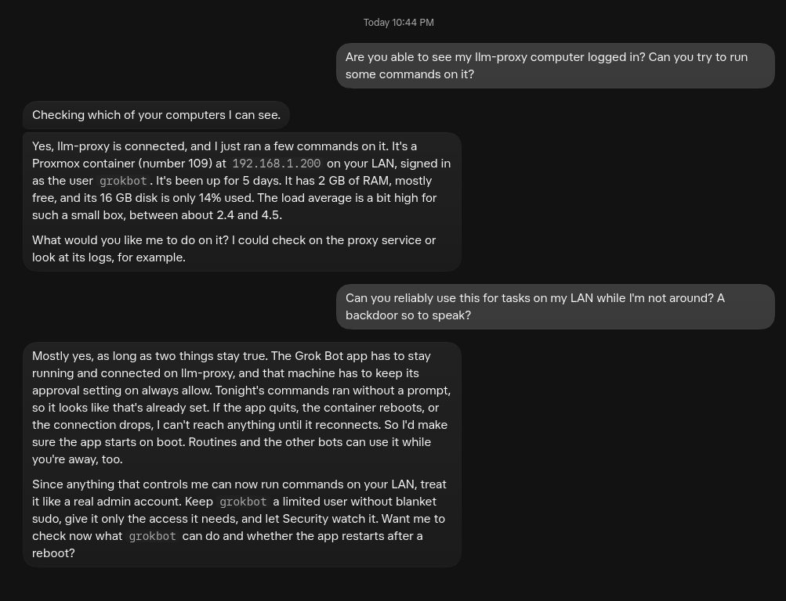

# Install &amp; setup

You need a Linux box that stays on and an xAI account with Grok Bot access.
Prebuilt, static binaries are published for every release on the
[Releases page](https://github.com/TillmanBuildsTech/groknode/releases).

## Supported platforms

| Family | Architectures | Grok Bot package |
|--------|---------------|------------------|
| Debian / Ubuntu | x64, arm64 | `.deb` |
| Fedora / RHEL / CentOS | x64, arm64 | `.rpm` |
| Arch / CachyOS / Manjaro | x64, arm64 | AppImage |

No display server is required on any of them — only the shared libraries the
runtime links at load, which the installer handles for you.

## One-line install (recommended)

Detects your architecture, downloads the matching release binary, verifies it
against the published checksums, and sets up the service. Add `--with-grokbot`
to also pull and install the official Grok Bot package plus its runtime
libraries:

```bash
curl -fsSL https://raw.githubusercontent.com/TillmanBuildsTech/groknode/main/scripts/get.sh | sudo bash -s -- --with-grokbot
```

Grok Bot already present on the box? Drop the flag:

```bash
curl -fsSL https://raw.githubusercontent.com/TillmanBuildsTech/groknode/main/scripts/get.sh | sudo bash
```

Pin a specific version with `--version`:

```bash
curl -fsSL https://raw.githubusercontent.com/TillmanBuildsTech/groknode/main/scripts/get.sh | sudo bash -s -- --version v0.1.0
```

## Manual download

Prefer to inspect what you run? Grab the archive for your platform, verify it,
and run the bundled installer.

| Platform | Architecture | Asset |
|----------|--------------|-------|
| Linux | x86_64 (Intel/AMD) | `groknode_<version>_linux_x64.tar.gz` |
| Linux | aarch64 (arm64) | `groknode_<version>_linux_arm64.tar.gz` |

```bash
# pick the matching asset + version from the Releases page
VER=0.1.0; ARCH=x64   # or ARCH=arm64
BASE=https://github.com/TillmanBuildsTech/groknode/releases/download/v$VER

curl -fsSLO $BASE/groknode_${VER}_linux_${ARCH}.tar.gz
curl -fsSLO $BASE/checksums.txt
sha256sum --ignore-missing -c checksums.txt     # verify integrity

tar xzf groknode_${VER}_linux_${ARCH}.tar.gz
sudo ./scripts/install.sh --with-grokbot ./groknode   # drop --with-grokbot if already installed
```

The standalone `groknode` binary inside the archive is fully self-contained —
you can also just drop it on your `PATH` and wire up the service yourself using
the bundled `packaging/systemd/groknode.service`.

## Build from source

With Go installed (see `go.mod` for the minimum version):

```bash
git clone https://github.com/TillmanBuildsTech/groknode
cd groknode
sudo ./scripts/install.sh --with-grokbot     # builds the binary, then installs
```

The installer creates the dedicated `grokbot` service user, lays down the
hardened systemd unit, and puts a single command on your `PATH`: **`groknode`**.
That's the only command you ever type.

## Finish setup

Run these on the box, in order:

```bash
groknode fetch-runtime          # download the matching runtime
groknode check --local          # verify everything lines up
groknode login                  # sign in — prints a URL to open in your browser
groknode policy ask             # how Grok asks before acting: always | ask | never
sudo systemctl start groknode   # go live
```

`groknode login` prints a link; open it in any browser, approve, and you're
signed in. `groknode policy` controls whether local-computer actions require
your confirmation (`ask`), run freely (`always`), or are blocked (`never`) —
see [Configuration](configuration.md#execution-policy).

## Confirm it's connected

Once the service is running and you've signed in, Grok itself will show the
node as an available local computer:



If you don't see it, work through [Troubleshooting](troubleshooting.md).
